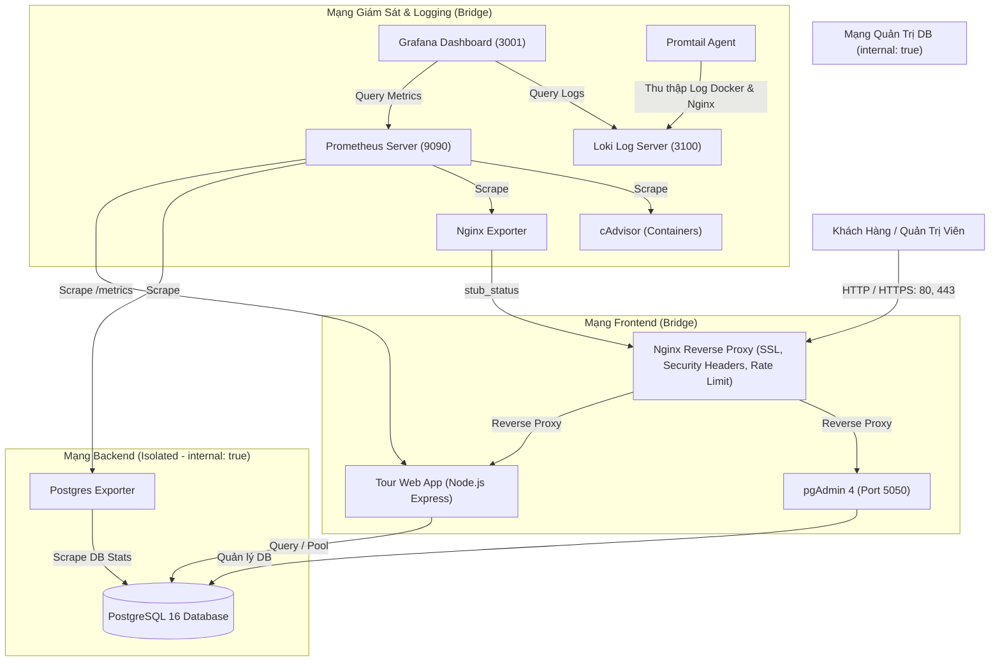

# ĐỀ 20: HỆ THỐNG BOOKING TOUR / DU LỊCH (VIETTOUR)

> **Báo cáo Thực hành / Đồ án môn học: Triển khai Hệ thống và DevOps**  
> **Sinh viên thực hiện:** Phí Đức Phi  
> **Mã số sinh viên (MSV):** DTC241200011  
> **Repository GitHub:** `dtc241200011_phiducphi`

---

## 1. TỔNG QUAN HỆ THỐNG

Hệ thống **VietTour Booking** là một nền tảng trực tuyến phục vụ tìm kiếm, quản lý lịch trình và đặt tour du lịch trọn gói. Toàn bộ hệ thống được container hóa bằng **Docker Compose** với kiến trúc Microservices / Multi-container hoàn chỉnh, tuân thủ các tiêu chuẩn DevSecOps khắt khe:

- **Ứng dụng Web:** Node.js (Express framework) + EJS View Engine + Bootstrap 5 responsive.
- **Cơ sở dữ liệu:** PostgreSQL 16 (chứa dữ liệu Tours, Lịch trình, Khách hàng, Đơn đặt chỗ) + pgAdmin 4 quản trị trực quan.
- **Reverse Proxy:** Nginx Alpine hỗ trợ HTTPS tự ký (SSL/TLS), Security Headers, Rate Limiting và Gzip.
- **Hệ thống giám sát (Monitoring):** Prometheus v2 + Grafana v10 + cAdvisor + Postgres Exporter + Nginx Prometheus Exporter.
- **Hệ thống ghi log tập trung (Logging):** Loki v2 + Promtail v2 + truy vấn LogQL trực quan.
- **Bảo mật chuyên sâu (Hardening):** Non-root user cho toàn bộ container, Network isolation (cô lập CSDL), hạn chế tài nguyên (CPU/RAM limit), chống tấn công DDoS cơ bản.



---

## 2. DANH MỤC DỊCH VỤ & CỔNG TRUY CẬP

| Dịch Vụ                        | Container Name     | Cổng Truy Cập Host                                             | Giao Thức / Tài Khoản                        |
| :----------------------------- | :----------------- | :------------------------------------------------------------- | :------------------------------------------- |
| **Website Đặt Tour (HTTPS)**   | `tour_nginx_proxy` | `https://localhost:8443`                                       | Khách hàng duyệt & đặt tour                  |
| **Website Đặt Tour (HTTP)**    | `tour_nginx_proxy` | `http://localhost:8080`                                        | Tự động chuyển hướng sang HTTPS              |
| **pgAdmin 4 (Quản trị DB)**    | `tour_pgadmin`     | `http://localhost:5050` hoặc `https://localhost:8443/pgadmin/` | `admin@viettour.vn` / `AdminSecurePass2024!` |
| **Grafana Dashboard**          | `tour_grafana`     | `http://localhost:3001`                                        | `admin` / `GrafanaAdmin2024!`                |
| **Prometheus Web UI**          | `tour_prometheus`  | `http://localhost:9090`                                        | Không cần mật khẩu                           |
| **Web App Health Check**       | `tour_web_app`     | `https://localhost:8443/healthz`                               | JSON `{status: "healthy"}`                   |
| **Web App Prometheus Metrics** | `tour_web_app`     | `https://localhost:8443/metrics`                               | Plain text OpenMetrics                       |
| **Loki Log Engine**            | `tour_loki`        | `http://localhost:3100`                                        | Log API endpoint                             |

---

## 3. HƯỚNG DẪN KHỞI CHẠY (QUICK START)

### Bước 1: Chuẩn bị môi trường

Yêu cầu máy tính đã cài đặt **Docker Desktop** (hỗ trợ Compose v2).

### Bước 2: Clone repository

```bash
git clone https://github.com/dtc241200011/dtc241200011_phiducphi.git
cd dtc241200011_phiducphi
```

### Bước 3: Khởi chạy toàn bộ hệ thống bằng Docker Compose

```bash
# Khởi chạy toàn bộ 11 container ở chế độ chạy nền
docker compose up -d --build
```

### Bước 4: Kiểm tra trạng thái hoạt động của các container

```bash
docker compose ps
```

_Tất cả 11 container phải hiển thị trạng thái `Up` (hoặc `healthy`). Nginx sẽ tự động sinh chứng chỉ SSL tự ký nếu chưa tồn tại._

---

## 4. CHI TIẾT 6 YÊU CẦU ĐỀ BÀI VÀ KẾT QUẢ ĐẠT ĐƯỢC

### Yêu Cầu 1: Quản lý mã nguồn trên GitHub với 3 Commit rõ ràng

Dự án được cấu trúc thành 3 commit độc lập tương ứng với tiến trình triển khai:

- **Commit 1:** `feat(web-proxy): deploy tour booking web app with postgresql, pgadmin and nginx reverse proxy with SSL`
- **Commit 2:** `feat(monitoring): integrate prometheus and grafana for web, postgresql, nginx and container metrics`
- **Commit 3:** `feat(logging-hardening): implement loki and promtail centralized logging with logql and security hardening`

_Sinh viên có thể chạy file script `scripts/git_commits.bat` (Windows) hoặc `scripts/git_commits.sh` (Linux) để tự động tạo 3 commit chuẩn._

---

### Yêu Cầu 2: Ứng dụng Web Đặt Tour Du Lịch + PostgreSQL + pgAdmin

- **Chức năng ứng dụng Web:**
  1. _Trang chủ (`/`):_ Tìm kiếm tour theo từ khóa, điểm đến, ngân sách; hiển thị thống kê hệ thống và tour nổi bật.
  2. _Danh sách Tour (`/tours`):_ Bộ lọc thông minh theo vùng miền, giá tiền, thời gian.
  3. _Chi tiết Tour & Lịch trình (`/tours/:id`):_ Hiển thị chi tiết từng ngày tham quan (Ngày 1, Ngày 2...), dịch vụ bao gồm/không bao gồm.
  4. _Đặt Tour trực tuyến (`/bookings/create`):_ Tính tổng tiền tự động theo số lượng người lớn và trẻ em; sinh mã đặt chỗ duy nhất (VD: `BK8821901`).
  5. _Tra cứu vé (`/bookings/lookup`):_ Tra cứu theo mã đặt tour để xem trạng thái đơn hàng.
  6. _Quản trị (`/admin`):_ Bảng điều khiển xem doanh thu, duyệt/hủy đơn đặt tour, thêm/sửa/xóa tour du lịch.
- **Cơ sở dữ liệu PostgreSQL:**
  - File khởi tạo `database/init.sql` tự động tạo bảng: `tours`, `itineraries`, `bookings` kèm chỉ mục (Index) tối ưu hiệu năng.
  - Cung cấp sẵn dữ liệu mẫu thực tế về du lịch Việt Nam: Đà Nẵng, Hạ Long, Phú Quốc, Sa Pa, Hà Giang, Đà Lạt.
- **pgAdmin 4:**
  - Tích hợp file `pgadmin/servers.json` tự động kết nối vào PostgreSQL ngay khi khởi chạy, không cần thao tác thêm server thủ công.

---

### Yêu Cầu 3: Nginx Reverse Proxy (HTTPS tự ký + Security Headers) [Commit 1]

- **Tự động sinh SSL/TLS:** Script `nginx/entrypoint.sh` tự động tạo khóa riêng `key.pem` và chứng chỉ `cert.pem` bằng OpenSSL nếu chưa có.
- **Security Headers chống tấn công:**
  - `X-Frame-Options: SAMEORIGIN` (chống Clickjacking).
  - `X-Content-Type-Options: nosniff` (chống MIME sniffing).
  - `X-XSS-Protection: 1; mode=block` (chống tấn công XSS).
  - `Strict-Transport-Security: max-age=31536000; includeSubDomains` (ép buộc HTTPS).
  - `Content-Security-Policy` (kiểm soát nguồn nạp script/style).
- **Rate Limiting:** `limit_req_zone $binary_remote_addr zone=one:10m rate=20r/s;` bảo vệ chống brute force và DoS.
- **Stub Status:** Kích hoạt tại `/nginx_status` để phục vụ `nginx-prometheus-exporter`.

---

### Yêu Cầu 4: Giám sát toàn diện Prometheus + Grafana [Commit 2]

- **Prometheus Scrape Config (`monitoring/prometheus/prometheus.yml`):**
  - Giám sát Web App: Thu thập metrics chuẩn OpenMetrics qua endpoint `/metrics` (`http_requests_total`, `http_request_duration_seconds`, `tour_bookings_total`, `tour_active_count`, `db_query_duration_seconds`).
  - Giám sát PostgreSQL: `postgres-exporter` thu thập số lượng kết nối `pg_stat_database_numbackends`, tốc độ commit giao dịch `pg_stat_database_xact_commit`.
  - Giám sát Nginx: `nginx-prometheus-exporter` thu thập số lượng kết nối chủ động `nginx_connections_active`, request/sec.
  - Giám sát Container: `cAdvisor` thu thập CPU, RAM, Network I/O của toàn bộ 11 container.
- **Grafana Provisioning:**
  - Tự động nạp Datasource (Prometheus, Loki).
  - Tự động nạp Dashboard hoàn chỉnh `VietTour - Tour Booking & Infrastructure Overview` hiển thị đầy đủ biểu đồ:
    - _Số tour đang bán_ (Stat gauge)
    - _Tổng đơn đặt tour_ (Stat counter)
    - _Tốc độ truy vấn HTTP_ (req/sec)
    - _Độ trễ P95_ (latency histogram)
    - _Biểu đồ mã phản hồi HTTP_ (200, 404, 500)
    - _Thời gian thực thi câu truy vấn Database_
    - _Trạng thái Nginx & PostgreSQL_

---

### Yêu Cầu 5: Hệ thống Log tập trung Loki + Promtail & Truy vấn LogQL [Commit 3]

- **Loki Server (`loki`):** Lưu trữ và lập chỉ mục nhật ký có cấu trúc từ tất cả các container và web server.
- **Promtail Agent (`promtail`):** Thu thập file log từ Nginx JSON access log và Docker container logs stream.
- **Các câu truy vấn LogQL mẫu (Thực hiện trên Grafana Explore -> Loki):**

#### Query 1: Lọc tất cả các yêu cầu HTTP lỗi (Client Error 4xx và Server Error 5xx)

```logql
{job="docker-logs"} |~ "status\":\\s*[45][0-9]{2}|level\":\\s*\"(error|warn)\""
```

_Mục đích:_ Phát hiện các request bị lỗi hoặc các ngoại lệ trong ứng dụng web.

#### Query 2: Lọc các sự kiện phát sinh đơn đặt tour mới (Business Event Logging)

```logql
{job="docker-logs"} |= "New Tour Booking created"
```

_Mục đích:_ Theo dõi tức thời luồng khách hàng vừa đặt tour du lịch thành công trên hệ thống kèm thông tin mã đơn, tên tour và số tiền.

#### Query 3: Thống kê tốc độ sinh log của hệ thống theo thời gian (Log Rate)

```logql
rate({job=~"docker-logs|nginx-logs"}[1m])
```

_Mục đích:_ Giám sát mật độ hoạt động và phát hiện lưu lượng truy cập bất thường.

#### Query 4: Phân tích Nginx Access Logs dạng JSON và trích xuất độ trễ request > 0.1s

```logql
{job="nginx-logs"} | json | request_time > 0.1
```

_Mục đích:_ Xác định các URL phản hồi chậm từ phía Reverse Proxy để tối ưu hóa hiệu năng.

---

### Yêu Cầu 6: Các biện pháp Hardening (Tăng cường bảo mật)

1. **Non-Root Containers:**
   - Ứng dụng web chạy dưới quyền người dùng không có đặc quyền: `USER node` (UID 1000).
   - Prometheus chạy dưới user `nobody` (UID 65534).
   - Grafana chạy dưới user `472`.
   - Loki chạy dưới user `10001`.
2. **Network Isolation (Phân vùng mạng nghiêm ngặt):**
   - Mạng `backend_net` được thiết lập `internal: true`. Container PostgreSQL hoàn toàn **không** expose cổng ra bên ngoài host, chỉ cho phép `web-app` và `postgres-exporter` truy cập trong nội bộ.
   - Mạng `admin_net` cô lập dành riêng cho kết nối giữa `pgadmin` và `postgres`.
   - Mạng `monitoring_net` tách biệt cho luồng thu thập dữ liệu giám sát.
3. **Mật khẩu mạnh & Biến môi trường:**
   - Tất cả mật khẩu mặc định đều tuân theo chuẩn bảo mật cao (chữ hoa, chữ thường, số, ký tự đặc biệt như `TourSecurePass2024!`).
   - Tách biệt cấu hình bảo mật ra file `.env` (không commit thông tin nhạy cảm).
4. **Hạn chế tài nguyên (Resource Limits):**
   - Mọi service trong `docker-compose.yml` đều được giới hạn CPU (`cpus: '0.50'`) và dung lượng RAM tối đa (`memory: 256M - 512M`) nhằm chống cạn kiệt tài nguyên máy chủ khi bị tấn công DoS.
5. **Nginx Hardening:**
   - Tắt hiển thị phiên bản máy chủ `server_tokens off;`.
   - Cấu hình Rate Limiting chống quét đường dẫn hoặc spam requests.
   - Bổ sung trọn bộ HTTP Security Headers chuẩn OWASP.

---

## 5. HƯỚNG DẪN KIỂM THỬ VÀ DEMO

### Kịch bản 1: Đặt thử một Tour du lịch

1. Mở trình duyệt truy cập: `https://localhost:8443` (Chấp nhận cảnh báo chứng chỉ tự ký).
2. Chọn tour _"Tour Đà Nẵng - Bán Đảo Sơn Trà - Bà Nà Hills - Hội An"_.
3. Nhập thông tin khách hàng, số lượng 2 người lớn, 1 trẻ em, chọn ngày khởi hành.
4. Bấm **Xác Nhận Đặt Tour**. Hệ thống sẽ cấp mã đặt tour dạng `BKxxxxxxx`.
5. Vào menu **Tra Cứu Booking**, nhập mã vừa nhận để kiểm tra trạng thái đơn.

### Kịch bản 2: Duyệt đơn đặt tour trong Trang Quản Trị

1. Truy cập `https://localhost:8443/admin`.
2. Trong tab **Danh Sách Đặt Tour**, chuyển trạng thái đơn hàng từ `Chờ duyệt` sang `Đã xác nhận`.
3. Kiểm tra thông số Tổng đơn đặt tour và Doanh thu trên bảng thống kê tự động cập nhật.

### Kịch bản 3: Kiểm tra Dashboard trên Grafana

1. Truy cập `http://localhost:3001` (Đăng nhập `admin` / `GrafanaAdmin2024!`).
2. Vào **Dashboards** -> Mở dashboard **VietTour - Tour Booking & Infrastructure Overview**.
3. Quan sát các biểu đồ Request Rate, Tour Bookings Total, Active Tours, Postgres Latency nhảy số theo thời gian thực.
4. Mở tab **Explore** trên thanh bên trái, chọn Data source là **Loki**, dán câu query:
   ```logql
   {job="docker-logs"} |= "New Tour Booking created"
   ```
   Bấm **Run query** để xem log chi tiết của đơn vừa đặt.

---

## 6. BÁO CÁO TỔNG HỢP (TỐI THIỂU 10 TRANG)

File tài liệu báo cáo chi tiết được lưu trữ tại thư mục:

- [Tài liệu Báo cáo Markdown: docs/BAO_CAO_TONG_HOP.md](file:///c:/Users/T/Documents/cacconaichuabaitrienkhai/dtc241200011_phiducphi/docs/BAO_CAO_TONG_HOP.md)
- [Bản in Báo cáo chuẩn A4 (Xuất PDF): docs/export_report.html](file:///c:/Users/T/Documents/cacconaichuabaitrienkhai/dtc241200011_phiducphi/docs/export_report.html)
  _(Người chấm chỉ cần mở file `export_report.html` bằng trình duyệt và bấm `Ctrl + P` -> "Lưu dưới dạng PDF" để nhận bản in hoàn chỉnh chuẩn mẫu báo cáo tốt nghiệp/thực tập dài hơn 10 trang)._
