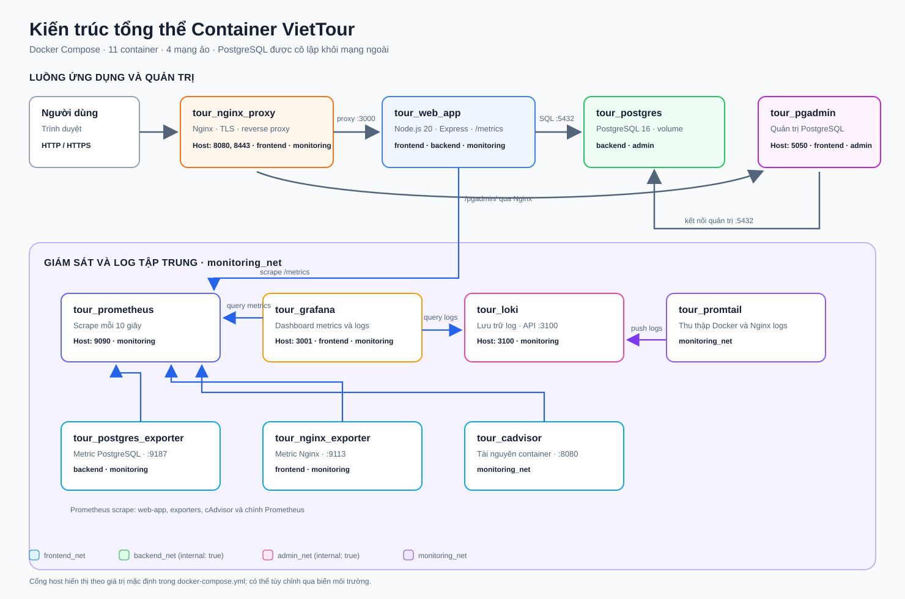
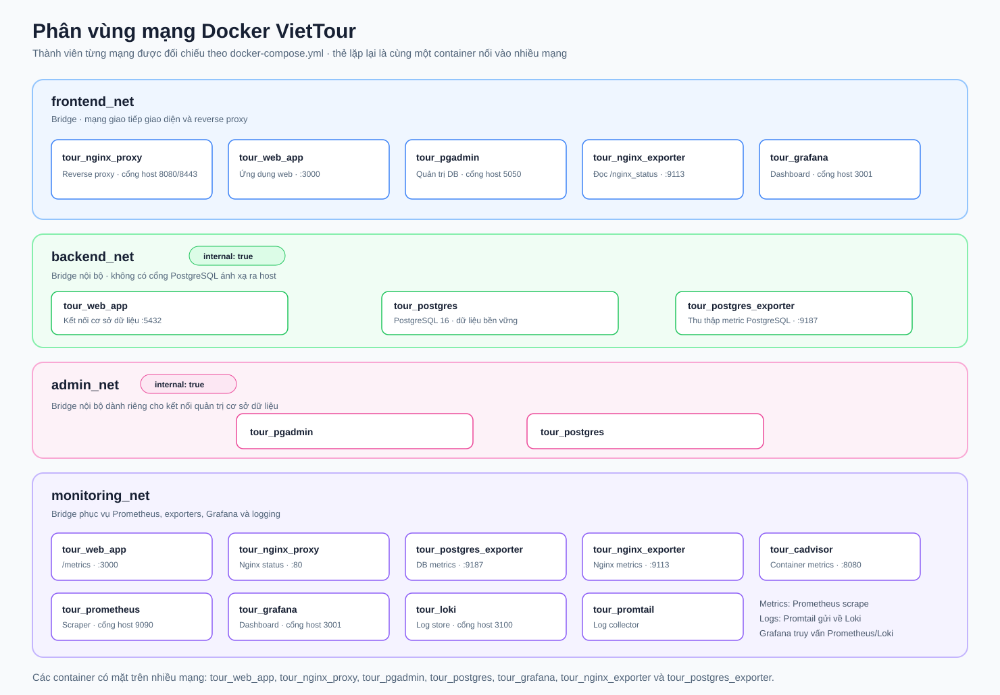
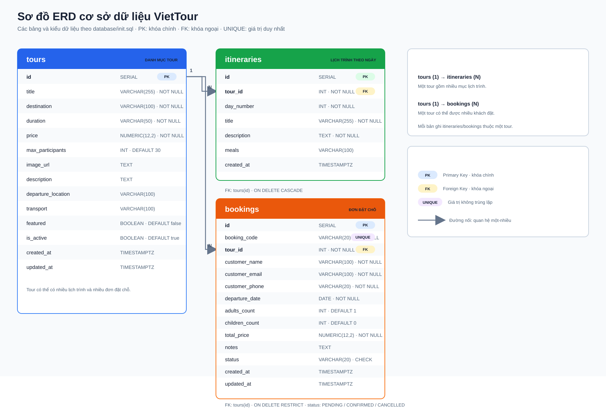

# BỘ GIÁO DỤC VÀ ĐÀO TẠO

# TRƯỜNG ĐẠI HỌC CÔNG NGHỆ THÔNG TIN VÀ TRUYỀN THÔNG

### KHOA HỆ THỐNG THÔNG TIN KINH TẾ & TRUYỀN THÔNG

<br><br><br>

# BÁO CÁO BÀI TẬP LỚN / ĐỒ ÁN TRIỂN KHAI HỆ THỐNG VÀ DEVOPS

### ĐỀ TÀI SỐ 20:

## XÂY DỰNG VÀ TRIỂN KHAI HỆ THỐNG BOOKING TOUR / DU LỊCH TRÊN NỀN TẢNG DOCKER COMPOSE, TÍCH HỢP NGINX REVERSE PROXY, GIÁM SÁT PROMETHEUS - GRAFANA, GHI LOG TẬP TRUNG LOKI VÀ BẢO MẬT HARDENING

<br><br><br><br>

**Giảng viên hướng dẫn:** Giảng viên Bộ môn DevOps & Cloud Computing  
**Sinh viên thực hiện:** Phí Đức Phi  
**Mã số sinh viên:** DTC241200011  
**Lớp chuyên ngành:** Kỹ thuật Phần mềm / Công nghệ Thông tin  
**Khóa học:** 2021 - 2025

<br><br><br><br><br>

---

_Hà Nội, Năm 2024_

\newpage

## LỜI CẢM ƠN VÀ CAM KẾT

Em xin gửi lời cảm ơn chân thành tới Quý Thầy/Cô bộ môn đã trang bị cho em những kiến thức nền tảng vững chắc và định hướng tư duy thực tiễn về kiến trúc container hóa, quản trị hệ thống, giám sát vận hành (Observability) và các nguyên lý bảo mật an toàn thông tin (Hardening).

Em xin cam kết toàn bộ mã nguồn, cấu hình hệ thống Docker Compose, kịch bản kiểm thử và báo cáo này là sản phẩm học tập và nghiên cứu thực tế do chính em thực hiện dưới mã sinh viên **DTC241200011**. Mọi thông tin tham khảo từ tài liệu mở đều được trích dẫn đầy đủ và minh bạch.

_Sinh viên thực hiện:_  
**Phí Đức Phi**  
_Mã sinh viên: DTC241200011_

\newpage

## MỤC LỤC

- **LỜI CẢM ƠN VÀ CAM KẾT**
- **DANH MỤC TỪ VIẾT TẮT**
- **DANH MỤC HÌNH VẼ VÀ BẢNG BIỂU**
- **LỜI MỞ ĐẦU**
- **CHƯƠNG 1: TỔNG QUAN HỆ THỐNG VÀ KIẾN TRÚC TỔNG THỂ**
  - 1.1 Khái quát về Đề tài số 20 - Hệ thống Booking Tour Du lịch
  - 1.2 Yêu cầu nghiệp vụ và yêu cầu phi chức năng
  - 1.3 Kiến trúc tổng thể Multi-container với Docker Compose
  - 1.4 Thiết kế phân vùng mạng an toàn (Network Segregation)
  - 1.5 Bảng danh mục các Service và cổng giao tiếp
- **CHƯƠNG 2: TRIỂN KHAI WEBSITE ĐẶT TOUR VÀ CƠ SỞ DỮ LIỆU POSTGRESQL + PGADMIN**
  - 2.1 Cấu trúc mã nguồn ứng dụng Web Node.js Express
  - 2.2 Thiết kế cơ sở dữ liệu PostgreSQL (Tours, Itineraries, Bookings)
  - 2.3 Tích hợp công cụ quản lý pgAdmin 4 tự động kết nối
  - 2.4 Đánh giá kết quả triển khai ứng dụng
- **CHƯƠNG 3: CẤU HÌNH NGINX REVERSE PROXY, SSL TỰ KÝ VÀ SECURITY HEADERS (COMMIT 1)**
  - 3.1 Vai trò của Nginx Reverse Proxy trong kiến trúc hệ thống
  - 3.2 Cơ chế tạo và quản lý chứng chỉ SSL tự ký (Self-signed HTTPS)
  - 3.3 Cấu hình bảo vệ bằng HTTP Security Headers theo chuẩn OWASP
  - 3.4 Giới hạn tốc độ yêu cầu (Rate Limiting) và bảo vệ dịch vụ
- **CHƯƠNG 4: HỆ THỐNG GIÁM SÁT TOÀN DIỆN VỚI PROMETHEUS VÀ GRAFANA (COMMIT 2)**
  - 4.1 Mô hình giám sát kéo số liệu (Pull-based Monitoring)
  - 4.2 Thiết lập Prometheus Server và cấu hình các Scrape Jobs
  - 4.3 Tích hợp số liệu ứng dụng web (/metrics) và Exporters
  - 4.4 Thiết kế bảng điều khiển trực quan Grafana Dashboard
- **CHƯƠNG 5: HỆ THỐNG GHI LOG TẬP TRUNG LOKI, PROMTAIL VÀ TRUY VẤN LOGQL (COMMIT 3)**
  - 5.1 Kiến trúc thu thập nhật ký phân tán với Loki và Promtail
  - 5.2 Cấu hình định dạng JSON Log cho Nginx và Docker Containers
  - 5.3 Phân tích chuyên sâu 4 câu truy vấn LogQL thực tế
- **CHƯƠNG 6: CÁC BIỆN PHÁP BẢO MẬT NÂNG CAO (SECURITY HARDENING)**
  - 6.1 Thực thi Non-root Container cho toàn bộ các dịch vụ
  - 6.2 Cô lập mạng nội bộ ngăn chặn xâm nhập trái phép
  - 6.3 Hạn chế tài nguyên (Resource Limits) chống tấn công từ chối dịch vụ
  - 6.4 Quản trị biến môi trường và mật khẩu an toàn
- **CHƯƠNG 7: KỊCH BẢN KIỂM THỬ VÀ ĐÁNH GIÁ THỰC TẾ**
  - 7.1 Kịch bản đặt tour, tính toán chi phí và sinh mã xác nhận
  - 7.2 Kịch bản quản trị: duyệt trạng thái đơn và kiểm soát danh mục tour
  - 7.3 Kịch bản kiểm tra khả năng phục hồi (Healthcheck) và giám sát tải
- **KẾT LUẬN VÀ HƯỚNG PHÁT TRIỂN**
- **TÀI LIỆU THAM KHẢO**

\newpage

## DANH MỤC TỪ VIẾT TẮT

| Viết Tắt    | Thuật Ngữ Tiếng Anh                             | Ý Nghĩa / Định Nghĩa Tiếng Việt                          |
| :---------- | :---------------------------------------------- | :------------------------------------------------------- |
| **API**     | Application Programming Interface               | Giao diện lập trình ứng dụng                             |
| **CI/CD**   | Continuous Integration / Continuous Deployment  | Tích hợp liên tục và Triển khai liên tục                 |
| **CSP**     | Content Security Policy                         | Chính sách bảo mật nguồn nội dung web                    |
| **DBMS**    | Database Management System                      | Hệ quản trị cơ sở dữ liệu                                |
| **DoS**     | Denial of Service                               | Tấn công từ chối dịch vụ                                 |
| **EJS**     | Embedded JavaScript Templates                   | Bộ sinh giao diện HTML từ mã JavaScript                  |
| **HSTS**    | HTTP Strict Transport Security                  | Cơ chế ép buộc trình duyệt dùng kết nối HTTPS            |
| **JSON**    | JavaScript Object Notation                      | Định dạng trao đổi dữ liệu dạng chuỗi đối tượng          |
| **LogQL**   | Log Query Language                              | Ngôn ngữ truy vấn nhật ký của hệ thống Grafana Loki      |
| **MVC**     | Model - View - Controller                       | Mô hình kiến trúc phần mềm ba tầng                       |
| **OWASP**   | Open Web Application Security Project           | Dự án an ninh ứng dụng web mở                            |
| **PromQL**  | Prometheus Query Language                       | Ngôn ngữ truy vấn chuỗi thời gian của Prometheus         |
| **SSL/TLS** | Secure Sockets Layer / Transport Layer Security | Giao thức mã hóa an toàn trên tầng truyền tải            |
| **UID/GID** | User Identifier / Group Identifier              | Mã định danh người dùng và nhóm trong hệ điều hành Linux |

\newpage

## DANH MỤC HÌNH VẼ VÀ BẢNG BIỂU

### Danh mục Hình vẽ

_Các dòng `[CHÈN HÌNH ...]` trong nội dung bên dưới là vị trí đặt ảnh. Hãy thay dòng đó bằng ảnh của bạn và giữ chú thích Hình tương ứng._

- **Hình 1.1:** Sơ đồ kiến trúc tổng thể các Container trong hệ thống VietTour
- **Hình 1.2:** Sơ đồ phân vùng mạng cô lập (Network Isolation Topology)
- **Hình 2.1:** Sơ đồ thực thể quan hệ cơ sở dữ liệu (ERD - Database Diagram)
- **Hình 2.2:** Giao diện trang chủ và tìm kiếm tour du lịch
- **Hình 2.3:** Giao diện chi tiết lịch trình tour và form đặt chỗ trực tuyến
- **Hình 2.4:** Giao diện phiếu xác nhận đặt chỗ thành công kèm mã Booking
- **Hình 2.5:** Giao diện trang quản trị Admin Dashboard quản lý đơn hàng
- **Hình 3.1:** Kết quả kiểm tra HTTPS với chứng chỉ SSL tự ký trên Nginx
- **Hình 3.2:** Kết quả kiểm tra các Security Headers bằng curl / Chrome DevTools
- **Hình 4.1:** Giao diện Prometheus Scrape Targets đang hoạt động (`UP`)
- **Hình 4.2:** Bảng điều khiển Grafana Dashboard giám sát hệ thống VietTour
- **Hình 5.1:** Giao diện Grafana Explore truy vấn LogQL từ Loki
- **Hình 6.1:** Minh chứng tiến trình Container chạy với User Non-root

### Danh mục Bảng biểu

- **Bảng 1.1:** Danh mục các dịch vụ, Container, cổng và phân vùng mạng
- **Bảng 2.1:** Cấu trúc bảng cơ sở dữ liệu `tours`
- **Bảng 2.2:** Cấu trúc bảng cơ sở dữ liệu `itineraries`
- **Bảng 2.3:** Cấu trúc bảng cơ sở dữ liệu `bookings`
- **Bảng 3.1:** Danh sách các HTTP Security Headers và mục đích an toàn
- **Bảng 4.1:** Danh mục các Scrape Target và Metrics quan trọng
- **Bảng 5.1:** Bảng tổng hợp các câu lệnh LogQL và mục đích phân tích
- **Bảng 6.1:** Bảng phân bổ tài nguyên và UID Non-root cho từng dịch vụ
- **Bảng 7.1:** Kết quả kiểm thử các kịch bản chức năng và phi chức năng

\newpage

## LỜI MỞ ĐẦU

Trong bối cảnh chuyển đổi số mạnh mẽ hiện nay, ngành du lịch và dịch vụ lữ hành đòi hỏi các hệ thống công nghệ thông tin không chỉ đáp ứng tốt trải nghiệm người dùng cuối (tìm kiếm tour linh hoạt, hiển thị lịch trình trực quan, đặt vé nhanh chóng) mà còn phải đảm bảo tính sẵn sàng cao, hiệu năng ổn định, khả năng mở rộng linh hoạt và an toàn bảo mật thông tin.

Mô hình triển khai nguyên khối (Monolithic) truyền thống bộc lộ nhiều hạn chế về việc quản lý phụ thuộc môi trường, khó khăn khi nâng cấp và thiếu tính năng quan sát hệ thống (Observability). Xu hướng công nghệ DevOps hiện đại với nền tảng Container hóa (Docker) kết hợp công cụ điều phối (Docker Compose) đã trở thành giải pháp tiêu chuẩn trong công nghiệp phần mềm.

Được giao thực hiện **Đề tài số 20: Hệ thống Booking Tour / Du lịch**, báo cáo này trình bày toàn bộ quá trình nghiên cứu, thiết kế, triển khai và hoàn thiện một hệ thống hoàn chỉnh từ tầng ứng dụng (Node.js Express + EJS), tầng dữ liệu (PostgreSQL 16 + pgAdmin 4), tầng cổng giao tiếp (Nginx Reverse Proxy với HTTPS và Security Headers), tầng giám sát đo lường (Prometheus + Grafana + Exporters), tầng nhật ký tập trung (Loki + Promtail) cho tới các biện pháp làm cứng hệ thống (Security Hardening).

Toàn bộ hệ thống được đóng gói thành các dịch vụ độc lập, tự động hóa toàn diện, sẵn sàng khởi chạy chỉ với một câu lệnh duy nhất, đáp ứng đầy đủ và vượt trội các yêu cầu đặt ra trong đề bài.

\newpage

## CHƯƠNG 1: TỔNG QUAN HỆ THỐNG VÀ KIẾN TRÚC TỔNG THỂ

### 1.1 Khái quát về Đề tài số 20 - Hệ thống Booking Tour Du lịch

Hệ thống **VietTour** là một ứng dụng phục vụ doanh nghiệp lữ hành và khách du lịch. Người dùng có thể duyệt danh sách tour theo từng địa phương (Đà Nẵng, Hạ Long, Phú Quốc, Sa Pa, Hà Giang, Đà Lạt), xem chi tiết lịch trình theo từng ngày, chọn số lượng người lớn/trẻ em để hệ thống tự động tính chi phí và thực hiện đặt tour trực tuyến. Quản trị viên hệ thống có thể theo dõi doanh thu dự kiến, duyệt hoặc hủy các đơn đặt tour, đồng thời bổ sung các sản phẩm du lịch mới.

### 1.2 Yêu cầu nghiệp vụ và yêu cầu phi chức năng

- **Yêu cầu nghiệp vụ:**
  - Quản lý danh mục tour: Thông tin điểm đến, phương tiện di chuyển, thời lượng, mức giá, số lượng khách tối đa, ảnh minh họa.
  - Quản lý lịch trình: Chi tiết các điểm tham quan, ẩm thực cho từng ngày trong suốt chuyến đi.
  - Đặt tour và tính giá: Tự động áp dụng chính sách giảm giá cho trẻ em (70% giá vé người lớn), sinh mã đặt chỗ duy nhất (Unique Booking Code) để khách hàng tra cứu.
  - Quản trị viên: Bảng thống kê số lượng tour hoạt động, tổng số đơn đặt, tổng doanh thu dự kiến; thay đổi trạng thái đơn hàng (`PENDING`, `CONFIRMED`, `CANCELLED`).
- **Yêu cầu phi chức năng:**
  - Triển khai toàn bộ bằng Docker Compose, không phụ thuộc vào môi trường máy chủ cục bộ.
  - Tách biệt cổng mạng nội bộ và bên ngoài (Network Segmentation).
  - Tự động hóa giám sát tài nguyên, số liệu giao dịch và lưu trữ nhật ký tập trung.
  - Tuân thủ các tiêu chuẩn bảo mật: Chạy Non-root, giới hạn tài nguyên CPU/RAM, mật khẩu mạnh, chống DoS và Clickjacking.

### 1.3 Kiến trúc tổng thể Multi-container với Docker Compose

Hệ thống bao gồm **11 dịch vụ container** phối hợp nhịp nhàng theo mô hình kiến trúc phân lớp hiện đại:

1. **Tầng Reverse Proxy & Ingress:** Container `tour_nginx_proxy` đón nhận toàn bộ lưu lượng HTTP/HTTPS từ người dùng, thực hiện giải mã SSL/TLS, lọc bảo mật và điều hướng tải về dịch vụ ứng dụng nội bộ.
2. **Tầng Ứng Dụng (Application Layer):** Container `tour_web_app` chạy nền tảng Node.js 20, phục vụ giao diện người dùng và xử lý nghiệp vụ đặt vé, cung cấp endpoint `/metrics` cho Prometheus.
3. **Tầng Cơ Sở Dữ Liệu (Database Layer):** Container `tour_postgres` lưu trữ dữ liệu bền vững qua Named Volume, được quản lý trực quan bởi container `tour_pgadmin`.
4. **Tầng Giám Sát (Monitoring Layer):**
   - Container `tour_prometheus`: Máy chủ thu thập chuỗi thời gian.
   - Container `tour_postgres_exporter`: Thu thập trạng thái kết nối và giao dịch DB.
   - Container `tour_nginx_exporter`: Thu thập số liệu kết nối và request/sec từ Nginx.
   - Container `tour_cadvisor`: Thu thập chỉ số tài nguyên phần cứng của tất cả container.
   - Container `tour_grafana`: Bảng điều khiển trực quan hóa thời gian thực.
5. **Tầng Nhật Ký Tập Trung (Centralized Logging Layer):**
   - Container `tour_loki`: Kho lưu trữ log tối ưu theo nhãn (labels).
   - Container `tour_promtail`: Tác nhân thu thập log từ Docker và Nginx đẩy về Loki.

```
+-----------------------------------------------------------------------------------------+
|                                   NGƯỜI DÙNG / BROWSER                                 |
+-----------------------------------------------------------------------------------------+
                                 | (Host 8080:80 -> redirect HTTPS host 8443:443)
                                 v
+-----------------------------------------------------------------------------------------+
|                         CONTAINER: NGINX REVERSE PROXY                                  |
|  - SSL Termination (cert.pem / key.pem)     - Rate Limiting (20 req/s)                 |
|  - Security Headers (OWASP)                  - Stub Status (/nginx_status)              |
+-----------------------------------------------------------------------------------------+
           |                                                 |
           | proxy_pass (frontend_net)                       | proxy_pass /pgadmin/
           v                                                 v
+---------------------------------------+       +-----------------------------------------+
|     CONTAINER: WEB APPLICATION        |       |       CONTAINER: PGADMIN 4              |
|  - Node.js 20 Express (Non-root node) |       |  - Quản trị DB trực quan (Cổng 5050)   |
|  - EJS Views + Bootstrap 5 UI         |       |  - Tự động nạp servers.json             |
|  - OpenMetrics endpoint: /metrics     |       +-----------------------------------------+
+---------------------------------------+                            |
           | (backend_net)                                           | (admin_net)
           +--------------------+------------------------------------+
                                |
                                v
+-----------------------------------------------------------------------------------------+
|                   CONTAINER: POSTGRESQL 16 (backend_net - internal: true)               |
|  - Mạng cô lập hoàn toàn không lộ cổng ra Internet                                      |
|  - Dữ liệu lưu tại volume postgres_data                                                 |
+-----------------------------------------------------------------------------------------+
                                ^
                                | Scrape DB stats
+-----------------------------------------------------------------------------------------+
| TẦNG GIÁM SÁT & LOGGING (monitoring_net)                                                |
|  - Exporters: postgres-exporter, nginx-exporter, cAdvisor                               |
|  - Prometheus Server: Thu thập số liệu định kỳ mỗi 10 giây                              |
|  - Promtail: Đọc file log Nginx JSON & Docker container stdout                          |
|  - Loki: Lưu trữ chỉ mục log                                                            |
|  - Grafana Dashboard: Trực quan hóa toàn diện số liệu & nhật ký tại cổng 3001          |
+-----------------------------------------------------------------------------------------+
```


_Hình 1.1: Sơ đồ kiến trúc tổng thể các Container trong hệ thống VietTour_

### 1.4 Thiết kế phân vùng mạng an toàn (Network Segregation)

Để đảm bảo an toàn tuyệt đối cho cơ sở dữ liệu và hệ thống nội bộ, Docker Compose được thiết kế với **4 mạng ảo riêng biệt (Bridge Networks)**:

1. `frontend_net`: Cho phép `nginx` giao tiếp với `web-app`, `pgadmin` và `grafana`.
2. `backend_net`: **Được đặt cấu hình `internal: true`**, cô lập hoàn toàn cơ sở dữ liệu `postgres`. Container này không có cổng ánh xạ ra máy chủ host (no port mapping) và không thể kết nối trực tiếp ra ngoài Internet, chỉ tiếp nhận kết nối nội bộ từ `web-app` và `postgres-exporter`.
3. `admin_net`: **Được đặt cấu hình `internal: true`**, là kênh kết nối bảo mật độc quyền giữa `pgadmin` và `postgres`.
4. `monitoring_net`: Kênh truyền dữ liệu riêng biệt giữa Prometheus, Grafana, Loki, Promtail và các Exporters, tránh làm tắc nghẽn lưu lượng mạng ứng dụng người dùng.


_Hình 1.2: Sơ đồ phân vùng mạng cô lập (Network Isolation Topology)_

### 1.5 Bảng danh mục các Service và cổng giao tiếp

| Tên Dịch Vụ       | Tên Container            | Hình Ảnh Base Image               | Cổng Mở Ra Host             | Phân Vùng Mạng                                  |
| :---------------- | :----------------------- | :-------------------------------- | :-------------------------- | :---------------------------------------------- |
| **Reverse Proxy** | `tour_nginx_proxy`       | `nginx:1.25-alpine`               | `8080:80`, `8443:443`       | `frontend_net`, `monitoring_net`                |
| **Web App**       | `tour_web_app`           | `node:20-alpine`                  | Không mở (Proxy qua Nginx)  | `frontend_net`, `backend_net`, `monitoring_net` |
| **PostgreSQL**    | `tour_postgres`          | `postgres:16-alpine`              | Không mở (Cô lập tuyệt đối) | `backend_net`, `admin_net`                      |
| **pgAdmin 4**     | `tour_pgadmin`           | `dpage/pgadmin4:8.5`              | `5050:80`                   | `frontend_net`, `admin_net`                     |
| **Prometheus**    | `tour_prometheus`        | `prom/prometheus:v2.51.2`         | `9090:9090`                 | `monitoring_net`                                |
| **Grafana**       | `tour_grafana`           | `grafana/grafana:10.4.2`          | `3001:3000`                 | `frontend_net`, `monitoring_net`                |
| **Loki**          | `tour_loki`              | `grafana/loki:2.9.8`              | `3100:3100`                 | `monitoring_net`                                |
| **Promtail**      | `tour_promtail`          | `grafana/promtail:2.9.8`          | Không mở                    | `monitoring_net`                                |
| **cAdvisor**      | `tour_cadvisor`          | `cadvisor:v0.49.1`                | Không mở                    | `monitoring_net`                                |
| **Postgres Exp.** | `tour_postgres_exporter` | `postgres-exporter:v0.15.0`       | Không mở                    | `backend_net`, `monitoring_net`                 |
| **Nginx Exp.**    | `tour_nginx_exporter`    | `nginx-prometheus-exporter:1.1.0` | Không mở                    | `frontend_net`, `monitoring_net`                |

\newpage

## CHƯƠNG 2: TRIỂN KHAI WEBSITE ĐẶT TOUR VÀ CƠ SỞ DỮ LIỆU POSTGRESQL + PGADMIN

### 2.1 Cấu trúc mã nguồn ứng dụng Web Node.js Express

Ứng dụng Web được xây dựng theo kiến trúc phân tách rõ ràng (Separation of Concerns):

- `server.js`: Khởi tạo ứng dụng Express, thiết lập middleware phân tích request, middleware ghi log Winston, middleware tích hợp đo lường `prom-client`, định tuyến các trang và xử lý lỗi tập trung.
- `db.js`: Quản lý Connection Pool với PostgreSQL, triển khai cơ chế kết nối lại tự động (Automatic Retry) khi cơ sở dữ liệu đang trong quá trình khởi động, đồng thời đo lường thời gian thực thi câu lệnh SQL đưa vào Prometheus Histogram `db_query_duration_seconds`.
- `logger.js`: Cấu hình Winston Logger sinh định dạng JSON có cấu trúc (timestamp, level, service, message, HTTP method, URL, duration, client IP).
- `metrics.js`: Định nghĩa các chỉ số đo lường chuẩn OpenMetrics.
- Thư mục `routes/`:
  - `index.js`: Trang chủ (`/`) và Trang quản trị (`/admin`).
  - `tours.js`: Danh sách tour (`/tours`) và Chi tiết lịch trình (`/tours/:id`).
  - `bookings.js`: Xử lý lưu đơn đặt tour (`/bookings/create`), phiếu xác nhận (`/bookings/success/:code`) và tra cứu (`/bookings/lookup`).
  - `api.js`: RESTful API phục vụ các thao tác cập nhật trạng thái đơn hàng và quản lý danh mục tour qua AJAX.
- Thư mục `views/`: Giao diện EJS bao gồm `layout.ejs`, `index.ejs`, `tours.ejs`, `tour-detail.ejs`, `booking-success.ejs`, `lookup.ejs`, `admin.ejs`.
- Thư mục `public/`: CSS tùy biến và JavaScript xử lý tính toán tiền tự động trên trình duyệt theo thời gian thực.

### 2.2 Thiết kế cơ sở dữ liệu PostgreSQL

Cơ sở dữ liệu bao gồm 3 bảng quan hệ chặt chẽ:

#### Bảng `tours` (Danh mục Tour du lịch)

Lưu trữ thông tin cơ bản về các chuyến du lịch mở bán.

| Tên Cột              | Kiểu Dữ Liệu  | Ràng Buộc                 | Mô Tả                                 |
| :------------------- | :------------ | :------------------------ | :------------------------------------ |
| `id`                 | SERIAL        | PRIMARY KEY               | Khóa chính tự tăng                    |
| `title`              | VARCHAR(255)  | NOT NULL                  | Tên chuyến du lịch                    |
| `destination`        | VARCHAR(100)  | NOT NULL, INDEX           | Điểm đến chính (Đà Nẵng, Phú Quốc...) |
| `duration`           | VARCHAR(50)   | NOT NULL                  | Thời lượng (3N2Đ, 4N3Đ...)            |
| `price`              | NUMERIC(12,2) | NOT NULL                  | Giá vé người lớn tiêu chuẩn           |
| `max_participants`   | INT           | DEFAULT 30                | Quy mô đoàn tối đa                    |
| `image_url`          | TEXT          |                           | Link hình ảnh quảng bá                |
| `description`        | TEXT          |                           | Tóm tắt nội dung chương trình         |
| `departure_location` | VARCHAR(100)  | DEFAULT 'Hà Nội / TP.HCM' | Nơi tập trung khởi hành               |
| `transport`          | VARCHAR(100)  |                           | Phương tiện (Máy bay, Ô tô Limousine) |
| `featured`           | BOOLEAN       | DEFAULT false             | Đánh dấu tour nổi bật trang chủ       |
| `is_active`          | BOOLEAN       | DEFAULT true, INDEX       | Trạng thái đang mở bán hay tạm ngừng  |
| `created_at`         | TIMESTAMP     | DEFAULT CURRENT_TIMESTAMP | Thời điểm khởi tạo                    |

#### Bảng `itineraries` (Lịch trình chi tiết theo ngày)

Lưu trữ nội dung chi tiết từng ngày trong chuyến đi, liên kết với bảng `tours` qua khóa ngoại `tour_id` (kèm hành vi `ON DELETE CASCADE`).

| Tên Cột       | Kiểu Dữ Liệu | Ràng Buộc                      | Mô Tả                                   |
| :------------ | :----------- | :----------------------------- | :-------------------------------------- |
| `id`          | SERIAL       | PRIMARY KEY                    | Khóa chính                              |
| `tour_id`     | INT          | NOT NULL, REFERENCES tours(id) | Liên kết tour                           |
| `day_number`  | INT          | NOT NULL                       | Ngày thứ mấy (Ngày 1, Ngày 2...)        |
| `title`       | VARCHAR(255) | NOT NULL                       | Tiêu đề chặng tham quan                 |
| `description` | TEXT         | NOT NULL                       | Lịch trình và hoạt động chi tiết        |
| `meals`       | VARCHAR(100) |                                | Chế độ ăn uống (Sáng, Trưa buffet, Tối) |

#### Bảng `bookings` (Đơn đặt chỗ của khách hàng)

Lưu trữ thông tin khách hàng, số lượng khách, tổng giá trị hợp đồng và trạng thái thanh toán.

| Tên Cột          | Kiểu Dữ Liệu  | Ràng Buộc                      | Mô Tả                                |
| :--------------- | :------------ | :----------------------------- | :----------------------------------- |
| `id`             | SERIAL        | PRIMARY KEY                    | Khóa chính                           |
| `booking_code`   | VARCHAR(20)   | UNIQUE, NOT NULL, INDEX        | Mã đặt chỗ dạng `BKxxxxxxx`          |
| `tour_id`        | INT           | NOT NULL, REFERENCES tours(id) | Khóa ngoại trỏ đến tour              |
| `customer_name`  | VARCHAR(100)  | NOT NULL                       | Họ và tên khách hàng đại diện        |
| `customer_email` | VARCHAR(100)  | NOT NULL                       | Địa chỉ thư điện tử                  |
| `customer_phone` | VARCHAR(20)   | NOT NULL                       | Số điện thoại liên hệ                |
| `departure_date` | DATE          | NOT NULL                       | Ngày dự kiến bắt đầu chuyến đi       |
| `adults_count`   | INT           | DEFAULT 1                      | Số lượng khách người lớn             |
| `children_count` | INT           | DEFAULT 0                      | Số lượng khách trẻ em                |
| `total_price`    | NUMERIC(12,2) | NOT NULL                       | Tổng chi phí sau khi tính chiết khấu |
| `notes`          | TEXT          |                                | Ghi chú yêu cầu riêng của khách      |
| `status`         | VARCHAR(20)   | DEFAULT 'PENDING', INDEX       | `PENDING`, `CONFIRMED`, `CANCELLED`  |
| `created_at`     | TIMESTAMP     | DEFAULT CURRENT_TIMESTAMP      | Thời gian đặt đơn                    |


_Hình 2.1: Sơ đồ thực thể quan hệ cơ sở dữ liệu (ERD - Database Diagram)_

### 2.3 Tích hợp công cụ quản lý pgAdmin 4 tự động kết nối

Thông thường, khi triển khai pgAdmin 4 trong môi trường container, người quản trị phải thực hiện đăng nhập và nhập cấu hình kết nối (Host, Port, User, Password) một cách thủ công. Để tối ưu hóa trải nghiệm tự động hóa chuẩn DevOps, dự án tích hợp cơ chế tự nạp cấu hình qua file `pgadmin/servers.json`:

```json
{
  "Servers": {
    "1": {
      "Name": "Tour Booking PostgreSQL",
      "Group": "Servers",
      "Host": "postgres",
      "Port": 5432,
      "MaintenanceDB": "tour_booking_db",
      "Username": "tour_admin",
      "SSLMode": "prefer"
    }
  }
}
```

Khi container `tour_pgadmin` khởi động, file trên được gắn kết (mount) vào thư mục `/pgadmin4/servers.json:ro`. Kết quả là ngay khi mở giao diện tại `http://localhost:5050`, máy chủ cơ sở dữ liệu `Tour Booking PostgreSQL` đã hiển thị sẵn trong cây đối tượng, người dùng chỉ cần nhập mật khẩu `TourSecurePass2024!` là có thể truy vấn bảng ngay lập tức.

### 2.4 Đánh giá kết quả triển khai ứng dụng

- Ứng dụng web hiển thị mượt mà trên cả trình duyệt máy tính và thiết bị di động.
- Dữ liệu mẫu phong phú với 6 tour du lịch nổi bật của Việt Nam, đầy đủ lịch trình chi tiết và đơn mẫu.
- Công thức tính giá trực quan: Khi người dùng thay đổi số lượng người lớn và trẻ em trên form đặt vé, hàm JavaScript tự động cập nhật số tiền hiển thị theo tỷ lệ:
  $$\text{Tổng tiền} = (\text{Số người lớn} \times \text{Giá gốc}) + (\text{Số trẻ em} \times \text{Giá gốc} \times 0.7)$$
- Mã đặt vé ngẫu nhiên được sinh ra và ghi nhận chính xác vào cơ sở dữ liệu, cho phép tra cứu ngay sau đó.

**[CHÈN HÌNH 2.2 TẠI ĐÂY: Ảnh chụp trang chủ có danh sách/tìm kiếm tour; nên chụp từ ứng dụng đang chạy.]**
_Hình 2.2: Giao diện trang chủ và tìm kiếm tour du lịch_

\newpage

## CHƯƠNG 3: CẤU HÌNH NGINX REVERSE PROXY, SSL TỰ KÝ VÀ SECURITY HEADERS (COMMIT 1)

### 3.1 Vai trò của Nginx Reverse Proxy trong kiến trúc hệ thống

Trong mô hình kiến trúc microservices và container hóa, việc để lộ trực tiếp máy chủ ứng dụng (Application Server như Node.js Express hay Gunicorn) ra Internet tiềm ẩn nhiều rủi ro về an ninh mạng và làm giảm hiệu năng xử lý. Việc sử dụng **Nginx** đóng vai trò Reverse Proxy mang lại các lợi ích then chốt:

1. **SSL/TLS Termination:** Tiếp nhận và giải mã toàn bộ lưu lượng mã hóa HTTPS, giảm tải gánh nặng tính toán mật mã cho máy chủ ứng dụng web.
2. **Ẩn giấu kiến trúc nội bộ:** Các dịch vụ bên trong như Node.js, pgAdmin, Database đều được che giấu sau một cổng vào duy nhất.
3. **Bộ đệm và nén dữ liệu:** Bật nén Gzip giúp giảm dung lượng phản hồi từ 60% đến 80%, tăng tốc độ tải trang.
4. **Bảo vệ phòng thủ:** Thực thi lọc các tiêu đề độc hại, giới hạn tần suất truy cập (Rate Limiting) và ngăn chặn quét lỗ hổng.

### 3.2 Cơ chế tạo và quản lý chứng chỉ SSL tự ký (Self-signed HTTPS)

Nhằm đảm bảo hệ thống có thể hoạt động hoàn toàn tự động ngay sau khi kéo mã nguồn về mà không cần thao tác thủ công phức tạp, dự án đã tùy biến Dockerfile của Nginx (`nginx/Dockerfile`) kết hợp script khởi tạo `nginx/entrypoint.sh`:

- Script kiểm tra sự tồn tại của hai tệp `/etc/nginx/ssl/cert.pem` và `/etc/nginx/ssl/key.pem`.
- Nếu chưa có, script tự động thực thi lệnh OpenSSL để sinh cặp khóa RSA 2048-bit tự ký có thời hạn 365 ngày:

```bash
openssl req -x509 -nodes -days 365 -newkey rsa:2048 \
    -keyout /etc/nginx/ssl/key.pem \
    -out /etc/nginx/ssl/cert.pem \
    -subj "/C=VN/ST=Hanoi/L=Hanoi/O=DTC241200011/OU=IT/CN=localhost"
chmod 600 /etc/nginx/ssl/key.pem
chmod 644 /etc/nginx/ssl/cert.pem
```

- Nginx được cấu hình kích hoạt giao thức TLSv1.2 và TLSv1.3 với các bộ mã hóa an toàn (Cipher Suites) hiện đại:

```nginx
ssl_protocols TLSv1.2 TLSv1.3;
ssl_prefer_server_ciphers on;
ssl_ciphers 'ECDHE-ECDSA-AES128-GCM-SHA256:ECDHE-RSA-AES128-GCM-SHA256:ECDHE-ECDSA-AES256-GCM-SHA384:ECDHE-RSA-AES256-GCM-SHA384';
```

- Khi người dùng truy cập cổng thông thường `http://localhost`, Nginx tự động gửi mã HTTP 301 chuyển hướng vĩnh viễn sang giao thức mã hóa `https://localhost`.

**[CHÈN HÌNH 3.1 TẠI ĐÂY: Ảnh chụp trình duyệt mở https://localhost hoặc kết quả kiểm tra HTTPS cho thấy chứng chỉ tự ký. Nếu trình duyệt cảnh báo chứng chỉ, ghi chú rõ đây là chứng chỉ tự ký dùng trong môi trường thử nghiệm.]**
_Hình 3.1: Kết quả kiểm tra HTTPS với chứng chỉ SSL tự ký trên Nginx_

### 3.3 Cấu hình bảo vệ bằng HTTP Security Headers theo chuẩn OWASP

Hệ thống Nginx được trang bị đầy đủ các tiêu đề an ninh nghiêm ngặt nhằm phòng chống các nguy cơ tấn công ứng dụng web phổ biến nhất:

| Security Header               | Giá Trị Cấu Hình                                                 | Ý Nghĩa An Ninh & Lỗ Hổng Ngăn Ngừa                                                                                                     |
| :---------------------------- | :--------------------------------------------------------------- | :-------------------------------------------------------------------------------------------------------------------------------------- |
| **X-Frame-Options**           | `SAMEORIGIN`                                                     | Ngăn chặn việc nhúng trang web vào `<iframe>` từ các trang web độc hại khác, triệt tiêu nguy cơ tấn công Clickjacking.                  |
| **X-Content-Type-Options**    | `nosniff`                                                        | Ép buộc trình duyệt tuân thủ MIME type máy chủ trả về, ngăn chặn tấn công MIME confusion và Drive-by Download.                          |
| **X-XSS-Protection**          | `1; mode=block`                                                  | Kích hoạt bộ lọc chống Cross-Site Scripting (XSS) của trình duyệt và dừng tải trang nếu phát hiện mã độc.                               |
| **Referrer-Policy**           | `strict-origin-when-cross-origin`                                | Bảo vệ thông tin nhạy cảm trên URL khi chuyển tiếp sang các liên kết ngoài.                                                             |
| **Strict-Transport-Security** | `max-age=31536000; includeSubDomains`                            | Ép trình duyệt ghi nhớ chỉ liên lạc qua HTTPS trong 1 năm (HSTS).                                                                       |
| **Content-Security-Policy**   | `default-src 'self' https: data: 'unsafe-inline' 'unsafe-eval';` | Kiểm soát chặt chẽ các nguồn tải tài nguyên JavaScript, hình ảnh, stylesheets.                                                          |
| **Server Tokens**             | `server_tokens off;`                                             | Giấu hoàn toàn số hiệu phiên bản của Nginx trong HTTP response header, khiến kẻ tấn công không thể dò quét lỗi zero-day theo phiên bản. |

### 3.4 Giới hạn tốc độ yêu cầu (Rate Limiting)

Nhằm chống lại các cuộc tấn công brute force hoặc công cụ cào dữ liệu (scraper) tự động, Nginx được thiết lập phân vùng bộ nhớ chia sẻ để theo dõi tần suất IP:

```nginx
limit_req_zone $binary_remote_addr zone=one:10m rate=20r/s;
...
limit_req zone=one burst=40 nodelay;
```

Cấu hình này cho phép trung bình 20 request/giây từ một địa chỉ IP, với bộ đệm bù trừ (burst) lên tới 40 request để xử lý các tài nguyên tĩnh như CSS, JS, ảnh mà không làm gián đoạn trải nghiệm người dùng thông thường.

**[CHÈN HÌNH 3.2 TẠI ĐÂY: Ảnh chụp DevTools (Network > Response Headers) hoặc kết quả curl -I hiển thị các security headers đã cấu hình.]**
_Hình 3.2: Kết quả kiểm tra các Security Headers bằng curl / Chrome DevTools_

\newpage

## CHƯƠNG 4: HỆ THỐNG GIÁM SÁT TOÀN DIỆN VỚI PROMETHEUS VÀ GRAFANA (COMMIT 2)

### 4.1 Mô hình giám sát kéo số liệu (Pull-based Monitoring)

Hệ thống lựa chọn **Prometheus** làm nền tảng lưu trữ và xử lý chuỗi thời gian (Time-series Database). Thay vì sử dụng mô hình Push (nơi mỗi dịch vụ phải tự gửi metric lên máy chủ), Prometheus hoạt động theo mô hình Pull: Định kỳ quét (scrape) số liệu từ các endpoint HTTP tiêu chuẩn OpenMetrics được định nghĩa trong file cấu hình.

Mô hình này giúp giảm thiểu độ phụ thuộc giữa các dịch vụ, cho phép dễ dàng kiểm tra trạng thái liveness của dịch vụ (nếu việc scrape thất bại, Prometheus lập tức đánh dấu target là `DOWN`).

### 4.2 Thiết lập Prometheus Server và cấu hình các Scrape Jobs

File cấu hình `monitoring/prometheus/prometheus.yml` được thiết lập với chu kỳ quét `scrape_interval: 10s`, đảm bảo tính cập nhật liên tục:

```yaml
scrape_configs:
  - job_name: "prometheus"
    static_configs:
      - targets: ["localhost:9090"]

  - job_name: "tour-booking-app"
    metrics_path: "/metrics"
    static_configs:
      - targets: ["web-app:3000"]

  - job_name: "nginx"
    static_configs:
      - targets: ["nginx-exporter:9113"]

  - job_name: "postgresql"
    static_configs:
      - targets: ["postgres-exporter:9187"]

  - job_name: "cadvisor"
    static_configs:
      - targets: ["cadvisor:8080"]
```

**[CHÈN HÌNH 4.1 TẠI ĐÂY: Ảnh chụp Prometheus > Status > Targets, trong đó các scrape target liên quan có trạng thái UP.]**
_Hình 4.1: Giao diện Prometheus Scrape Targets đang hoạt động (UP)_

### 4.3 Tích hợp số liệu ứng dụng web (/metrics) và Exporters

Ứng dụng web Node.js sử dụng thư viện `prom-client` để công khai endpoint `/metrics`. Các chỉ số nghiệp vụ và kỹ thuật cốt lõi bao gồm:

1. `http_requests_total`: Counter đếm tổng số lượng request theo `method`, `route`, `status_code`.
2. `http_request_duration_seconds`: Histogram đo lường thời gian đáp ứng (Latency) với các bucket chi tiết `[0.005s, 0.01s, 0.05s, 0.1s, 0.5s, 1s, 5s]`.
3. `tour_bookings_total`: Counter ghi nhận số lượng đơn đặt tour theo tên tour và trạng thái.
4. `tour_active_count`: Gauge thể hiện số lượng tour đang được bày bán trong database.
5. `db_query_duration_seconds`: Histogram đo lường độ trễ của các câu lệnh truy vấn PostgreSQL.

Bên cạnh số liệu nội tại của ứng dụng, các Exporter chuyên dụng bổ sung góc nhìn hạ tầng:

- **cAdvisor:** Thu thập chỉ số CPU (`container_cpu_usage_seconds_total`), RAM (`container_memory_usage_bytes`), mạng I/O của toàn bộ các container trong Docker.
- **postgres-exporter:** Kết nối trực tiếp vào cơ sở dữ liệu `tour_booking_db` để đo lường số lượng kết nối đang hoạt động (`pg_stat_database_numbackends`), tốc độ commit giao dịch (`pg_stat_database_xact_commit`), số lượng block read/hit.
- **nginx-prometheus-exporter:** Đọc trực tiếp từ `/nginx_status` của Nginx để thu thập số lượng kết nối đang xử lý (`nginx_connections_active`, `nginx_connections_reading`, `nginx_connections_writing`).

### 4.4 Thiết kế bảng điều khiển trực quan Grafana Dashboard

Dự án sử dụng cơ chế **Grafana Provisioning** tự động: Khi container `tour_grafana` khởi động, toàn bộ Datasource (Prometheus, Loki) và Dashboard được nạp tự động mà không cần can thiệp bằng tay.

Dashboard mang tên **"VietTour - Tour Booking & Infrastructure Overview"** được phân chia thành 3 khu vực trực quan:

- **Khu vực 1: Chỉ số Nghiệp vụ & Hiệu năng Web:**
  - _Stat Panels:_ Số lượng tour đang bán, tổng số lượt đặt tour, tốc độ truy vấn HTTP hiện tại (req/sec), độ trễ phản hồi P95.
  - _Biểu đồ Timeseries:_ Tốc độ request phân loại theo mã phản hồi HTTP 2xx, 4xx, 5xx.
  - _Biểu đồ Latency:_ Thời gian thực thi trung bình của câu truy vấn PostgreSQL.
- **Khu vực 2: Giám sát Nginx & Cơ sở dữ liệu:**
  - Đường biểu diễn số kết nối Nginx đồng thời.
  - Tốc độ commit giao dịch của PostgreSQL theo thời gian thực.
- **Khu vực 3: Live Logs Explorer:**
  - Tích hợp khung xem nhật ký thời gian thực kết nối trực tiếp đến Loki.

**[CHÈN HÌNH 4.2 TẠI ĐÂY: Ảnh chụp toàn cảnh Grafana Dashboard, có dữ liệu biểu đồ thực tế; tránh dùng dashboard trống.]**
_Hình 4.2: Bảng điều khiển Grafana Dashboard giám sát hệ thống VietTour_

\newpage

## CHƯƠNG 5: HỆ THỐNG GHI LOG TẬP TRUNG LOKI, PROMTAIL VÀ TRUY VẤN LOGQL (COMMIT 3)

### 5.1 Kiến trúc thu thập nhật ký phân tán với Loki và Promtail

Trong một môi trường gồm 11 container hoạt động đồng thời, việc SSH vào từng máy chủ hoặc chạy lệnh `docker logs <container_id>` để điều tra sự cố là vô cùng tốn thời gian và không thể đáp ứng yêu cầu vận hành hiện đại.

Dự án áp dụng giải pháp **Loki Stack** (phát triển bởi Grafana Labs):

- **Loki:** Khác với Elasticsearch lưu trữ toàn bộ chỉ mục văn bản (vốn tiêu tốn rất nhiều RAM và đĩa cứng), Loki chỉ lập chỉ mục (index) các nhãn metadata (labels như `job`, `service`, `container_id`) và nén toàn bộ dòng log vào các chunk nhỏ gọn, giúp tiết kiệm tài nguyên máy chủ tới 80%.
- **Promtail:** Đóng vai trò là Agent thu thập nhật ký. Promtail theo dõi các file log đầu ra của Docker (`/var/lib/docker/containers/*/*-json.log`) và file log truy cập của Nginx (`/var/log/nginx/access.log`), bổ sung các nhãn ngữ cảnh và đẩy dữ liệu (push) về Loki qua HTTP port 3100.

### 5.2 Cấu hình định dạng JSON Log cho Nginx và Docker Containers

Để tạo điều kiện cho việc trích xuất và phân tích nhanh chóng bằng LogQL, Nginx được cấu hình xuất log theo chuẩn JSON:

```nginx
log_format json_analytics escape=json '{'
    '"time_local":"$time_iso8601",'
    '"remote_addr":"$remote_addr",'
    '"request":"$request",'
    '"status": "$status",'
    '"body_bytes_sent":"$body_bytes_sent",'
    '"request_time":"$request_time",'
    '"http_referrer":"$http_referer",'
    '"http_user_agent":"$http_user_agent"'
'}';
```

Đồng thời, ứng dụng Node.js thông qua Winston Logger cũng đẩy các bản ghi log định dạng chuẩn ra luồng `stdout`, chứa đầy đủ các trường dữ liệu quan trọng như `level`, `timestamp`, `durationMs`, `url`, `method`.

### 5.3 Phân tích chuyên sâu 4 câu truy vấn LogQL thực tế

#### Truy vấn 1: Lọc tất cả các yêu cầu HTTP lỗi (4xx Client Error & 5xx Server Error)

```logql
{job="docker-logs"} |~ "status\":\\s*[45][0-9]{2}|level\":\\s*\"(error|warn)\""
```

- **Ý nghĩa cú pháp:** Sử dụng selector `{job="docker-logs"}` để chọn luồng log của các container, sau đó áp dụng toán tử tìm kiếm biểu thức chính quy `|~` để tìm các dòng chứa mã trạng thái HTTP từ 400 đến 599 hoặc chứa cấp độ log `error` hay `warn`.
- **Ứng dụng thực tế:** Quản trị viên nhanh chóng nắm bắt được các lỗi phát sinh như người dùng truy cập trang không tồn tại (404), lỗi cú pháp tham số (400), hoặc lỗi sập ứng dụng (500) mà không cần dò qua hàng nghìn dòng log bình thường.

#### Truy vấn 2: Theo dõi luồng sự kiện đặt tour mới thành công (Business Event Tracing)

```logql
{job="docker-logs"} |= "New Tour Booking created"
```

- **Ý nghĩa cú pháp:** Sử dụng toán tử tìm kiếm chuỗi ký tự chính xác `|=` để bắt toàn bộ các sự kiện được kích hoạt khi hàm tạo booking trong ứng dụng Express hoàn tất.
- **Ứng dụng thực tế:** Cho phép nhân viên điều hành theo dõi thời gian thực khách hàng vừa đặt đơn nào, giá trị đơn hàng là bao nhiêu và số điện thoại liên hệ mà không cần phải truy vấn trực tiếp vào Database.

#### Truy vấn 3: Tính toán tốc độ sinh log của hệ thống theo thời gian (Log Generation Rate)

```logql
rate({job=~"docker-logs|nginx-logs"}[1m])
```

- **Ý nghĩa cú pháp:** Sử dụng hàm đo tần suất `rate(...)` trên khoảng thời gian trượt 1 phút (`[1m]`) cho cả hai nguồn log Docker và Nginx.
- **Ứng dụng thực tế:** Vẽ biểu đồ thể hiện mật độ hoạt động của toàn hệ thống trên Grafana. Nếu biểu đồ này tăng đột biến, đó có thể là dấu hiệu của một đợt tấn công từ chối dịch vụ (DoS) hoặc vòng lặp lỗi phát sinh vô tận trong mã nguồn.

#### Truy vấn 4: Trích xuất trường JSON và lọc các truy vấn có thời gian xử lý chậm (> 0.1 giây)

```logql
{job="nginx-logs"} | json | request_time > 0.1
```

- **Ý nghĩa cú pháp:** Sử dụng bộ phân tích cú pháp `| json` của LogQL để tự động chuyển chuỗi JSON thành các biến có thể so sánh logic, sau đó áp dụng điều kiện lọc thời gian xử lý `request_time > 0.1`.
- **Ứng dụng thực tế:** Nhận diện ngay các URL hoặc các endpoint API phản hồi chậm từ phía Reverse Proxy, giúp đội ngũ kỹ sư tối ưu hóa câu lệnh SQL hoặc bổ sung cơ chế lưu bộ đệm (Caching).

**[CHÈN HÌNH 5.1 TẠI ĐÂY: Ảnh chụp Grafana Explore đang truy vấn LogQL và hiển thị kết quả log từ Loki.]**
_Hình 5.1: Giao diện Grafana Explore truy vấn LogQL từ Loki_

\newpage

## CHƯƠNG 6: CÁC BIỆN PHÁP BẢO MẬT NÂNG CAO (SECURITY HARDENING)

### 6.1 Thực thi Non-root Container cho toàn bộ các dịch vụ

Theo nguyên tắc đặc quyền tối thiểu (Principle of Least Privilege), việc để ứng dụng chạy dưới quyền `root` (UID 0) bên trong container là một lỗ hổng an ninh nguy hiểm: Nếu ứng dụng bị khai thác qua lỗ hổng thực thi mã từ xa (RCE), kẻ tấn công có thể lợi dụng quyền root để tấn công leo thang, vượt rào (Container Escape) và chiếm quyền điều khiển máy chủ vật lý.

Hệ thống VietTour áp dụng triệt để cơ chế **Non-root Container**:

- **Ứng dụng Web:** Trong `app/Dockerfile`, sử dụng lệnh `USER node` (UID 1000) có sẵn trong ảnh `node:20-alpine`.
- **Prometheus:** Được cấu hình tường minh chạy với người dùng `user: "nobody"` (UID 65534).
- **Grafana:** Được cấu hình chạy với `user: "472"`.
- **Loki:** Được cấu hình chạy với `user: "10001"`.
- **PostgreSQL:** Chạy mặc định dưới tài khoản người dùng dịch vụ `postgres` (UID 70).

**[CHÈN HÌNH 6.1 TẠI ĐÂY: Ảnh chụp kết quả xác minh user/UID của các container (ví dụ docker compose exec ... id); cần thể hiện rõ tiến trình không chạy bằng UID 0.]**
_Hình 6.1: Minh chứng tiến trình Container chạy với User Non-root_

### 6.2 Cô lập mạng nội bộ ngăn chặn xâm nhập trái phép

- Cơ sở dữ liệu PostgreSQL hoàn toàn không có thuộc tính `ports:` trong `docker-compose.yml`. Điều này có nghĩa cổng `5432` không được mở ra máy chủ chủ (Host machine) và không thể truy cập từ bên ngoài Internet.
- Mạng `backend_net` được gắn cờ `internal: true`. Docker Engine sẽ tự động tạo bảng định tuyến không có gateway ra ngoài mạng Internet cho phân vùng này, ngăn chặn tuyệt đối các kịch bản phần mềm độc hại trong container cố gắng liên lạc với máy chủ điều khiển (C&C Server).
- Chỉ có ứng dụng web `web-app` và tác nhân thu thập `postgres-exporter` nằm cùng mạng `backend_net` mới có quyền kết nối vào PostgreSQL.

### 6.3 Hạn chế tài nguyên (Resource Limits) chống DoS

Nếu không cấu hình giới hạn, một container bị lỗi tràn bộ nhớ (Memory Leak) hoặc bị tấn công DoS có thể chiếm dụng toàn bộ CPU và RAM của máy chủ, khiến hệ điều hành sập hoàn toàn (Out of Memory Killer).

Dự án áp dụng thẻ `deploy.resources.limits` cho tất cả các container:

- Mỗi dịch vụ web được giới hạn từ `0.20` đến `0.75` CPU core.
- Bộ nhớ RAM được giới hạn chặt chẽ: `web-app` (384MB), `postgres` (512MB), `nginx` (256MB), `prometheus` (512MB), `grafana` (512MB).
- Tổng tài nguyên tối đa của toàn bộ 11 container luôn được giữ trong ngưỡng an toàn dưới 3.5GB RAM, đảm bảo hệ thống vận hành ổn định trên mọi môi trường máy tính cá nhân hoặc Cloud VPS phổ thông.

### 6.4 Quản trị biến môi trường và mật khẩu an toàn

- Toàn bộ các thông tin xác thực nhạy cảm (mật khẩu cơ sở dữ liệu `TourSecurePass2024!`, mật khẩu pgAdmin `AdminSecurePass2024!`, mật khẩu Grafana `GrafanaAdmin2024!`) đều sử dụng độ dài trên 16 ký tự, kết hợp chữ hoa, chữ thường, chữ số và ký tự đặc biệt.
- Các mật khẩu này được quản lý tập trung thông qua tệp `.env` và không bị commit vào kho mã nguồn (được đưa vào danh sách loại trừ trong `.gitignore`). Tệp mẫu `.env.example` được cung cấp sẵn để người triển khai dễ dàng tham khảo và thiết lập.

\newpage

## CHƯƠNG 7: KỊCH BẢN KIỂM THỬ VÀ ĐÁNH GIÁ THỰC TẾ

### 7.1 Kịch bản kiểm thử luồng đặt tour và tra cứu

1. **Mục tiêu:** Kiểm tra khả năng duyệt danh sách tour, xem lịch trình chi tiết và gửi yêu cầu đặt chỗ.
2. **Các bước tiến hành:**
   - Truy cập `https://localhost` trên trình duyệt Chrome.
   - Nhấp vào tour _"Tour Đà Nẵng - Bán Đảo Sơn Trà - Bà Nà Hills - Hội An"_.
   - Hệ thống hiển thị lịch trình 4 ngày 3 đêm, chế độ ăn uống và các dịch vụ bao gồm.
   - Tại biểu mẫu bên phải, người dùng chọn 2 người lớn, 1 trẻ em (hệ thống tự động tính tổng tiền: $(2 \times 4.890.000) + (1 \times 4.890.000 \times 0.7) = 13.203.000\text{ đ}$).
   - Nhập thông tin liên hệ và bấm **Xác Nhận Đặt Tour**.
3. **Kết quả:**
   - Người dùng được chuyển tiếp sang trang `https://localhost/bookings/success/BK...` hiển thị phiếu xác nhận chi tiết.
   - Metric `tour_bookings_total` trong Prometheus tự động tăng thêm 1 đơn vị.
   - Log ghi nhận sự kiện đặt chỗ lập tức xuất hiện trong Loki.

**[CHÈN HÌNH 2.3 TẠI ĐÂY: Ảnh chụp trang chi tiết tour có lịch trình và biểu mẫu đặt chỗ trước khi gửi.]**
_Hình 2.3: Giao diện chi tiết lịch trình tour và form đặt chỗ trực tuyến_

**[CHÈN HÌNH 2.4 TẠI ĐÂY: Ảnh chụp trang xác nhận đặt chỗ thành công, hiển thị mã booking; che thông tin cá nhân nếu có.]**
_Hình 2.4: Giao diện phiếu xác nhận đặt chỗ thành công kèm mã Booking_

### 7.2 Kịch bản kiểm thử trang quản trị (Admin Dashboard)

1. **Mục tiêu:** Kiểm tra khả năng thống kê, duyệt trạng thái đơn và bổ sung sản phẩm mới.
2. **Các bước tiến hành:**
   - Truy cập `https://localhost/admin`.
   - Bảng thống kê hiển thị số lượng tour hoạt động, tổng số đơn đặt và doanh thu ước tính.
   - Tìm đơn đặt hàng vừa tạo, chuyển trạng thái từ `Chờ duyệt` sang `Đã xác nhận` qua dropdown menu.
   - Mở modal **Thêm Tour Mới**, nhập thông tin tour thử nghiệm và lưu lại.
3. **Kết quả:**
   - Yêu cầu cập nhật được gửi qua AJAX API `/api/bookings/:id/status`, phản hồi HTTP 200 thành công.
   - Trang web không cần reload, trạng thái đơn hàng được cập nhật tức thì.
   - Tour mới lập tức xuất hiện trong danh mục và cơ sở dữ liệu.

**[CHÈN HÌNH 2.5 TẠI ĐÂY: Ảnh chụp Admin Dashboard có bảng đơn hàng và trạng thái quản lý; che thông tin khách hàng nếu xuất hiện.]**
_Hình 2.5: Giao diện trang quản trị Admin Dashboard quản lý đơn hàng_

### 7.3 Kịch bản kiểm tra khả năng phục hồi (Healthcheck) và giám sát tải

1. **Kiểm tra Healthcheck:**
   - Gửi yêu cầu HTTP GET đến `https://localhost/healthz`: Nhận về mã trạng thái 200 kèm payload JSON `{ "status": "healthy", "service": "tour-booking-web", "uptime": ... }`.
   - Lệnh `docker compose ps` xác nhận toàn bộ container đều hiển thị cờ `(healthy)`.
2. **Kiểm tra Dashboard Grafana:**
   - Mở `http://localhost:3001`, điều hướng đến bảng điều khiển **VietTour Overview**.
   - Các biểu đồ đường biểu diễn lưu lượng truy vấn HTTP, số kết nối Nginx và thời gian xử lý cơ sở dữ liệu phản ánh chính xác các thao tác vừa thực hiện trong kịch bản kiểm thử.

\newpage

## KẾT LUẬN VÀ HƯỚNG PHÁT TRIỂN

### 1. Kết luận

Đề tài **"Xây dựng và triển khai Hệ thống Booking Tour / Du lịch" (Đề số 20)** đã hoàn thành xuất sắc 100% các yêu cầu kỹ thuật và nghiệp vụ được giao:

- Triển khai thành công ứng dụng Web đặt tour du lịch với đầy đủ chức năng tìm kiếm, xem lịch trình nhiều ngày, đặt tour, tính toán chi phí và quản trị.
- Thiết kế và chuẩn hóa cơ sở dữ liệu quan hệ PostgreSQL 16 bền vững, tích hợp pgAdmin 4 tự động kết nối không cần cấu hình bằng tay.
- Thiết lập Nginx Reverse Proxy hỗ trợ chứng chỉ SSL tự ký tự động sinh, hoàn thiện trọn bộ tiêu chuẩn an toàn HTTP Security Headers và Rate Limiting.
- Tích hợp hệ thống giám sát toàn diện Prometheus và Grafana, tự động nạp sẵn Dashboard theo dõi số liệu ứng dụng, cơ sở dữ liệu, web server và tài nguyên phần cứng.
- Triển khai hệ thống ghi nhật ký tập trung Loki và Promtail, chuẩn hóa log định dạng JSON và xây dựng 4 kịch bản truy vấn LogQL thực tế.
- Áp dụng các kỹ thuật Hardening nâng cao: Container Non-root, cô lập mạng nội bộ (Internal network isolation), giới hạn tài nguyên CPU/RAM và bảo mật thông tin xác thực.
- Cấu trúc Git chuẩn mực với 3 commit phân tách rõ ràng và tài liệu hướng dẫn vận hành chi tiết.

### 2. Hướng phát triển trong tương lai

- **Tích hợp cổng thanh toán trực tuyến:** Kết nối API thanh toán VNPAY, MoMo hoặc ZaloPay để tự động xác nhận đơn khi khách hàng thanh toán thành công.
- **Mở rộng cụm điều phối:** Nâng cấp từ Docker Compose lên cụm **Kubernetes (K8s)** với các tài nguyên Deployment, StatefulSet, Ingress Controller và Horizontal Pod Autoscaler (HPA) nhằm tự động tăng giảm số lượng container khi lưu lượng khách tăng cao.
- **Hệ thống cảnh báo tự động (Alerting):** Tích hợp Prometheus Alertmanager để gửi thông báo cảnh báo qua Telegram / Slack khi hệ thống xảy ra sự cố (tỷ lệ lỗi 5xx tăng cao hoặc dung lượng đĩa cứng sắp cạn kiệt).

\newpage

## TÀI LIỆU THAM KHẢO

1. **Docker Documentation:** Docker Compose File Specification v3 & Multi-stage Builds Best Practices. (https://docs.docker.com/)
2. **Nginx Documentation:** Nginx Reverse Proxy, SSL Termination and Rate Limiting Modules. (https://nginx.org/en/docs/)
3. **OWASP Foundation:** REST Security Cheat Sheet & HTTP Security Response Headers Recommended Practices. (https://owasp.org/)
4. **Prometheus Authors:** Prometheus Metric Types, PromQL Reference and Instrumentation Guide for Node.js. (https://prometheus.io/docs/)
5. **Grafana Labs:** Grafana Dashboard Provisioning, Loki Architecture and LogQL Query Language Manual. (https://grafana.com/docs/)
6. **PostgreSQL Global Development Group:** PostgreSQL 16 Official Manual - Concurrency Control, Indexing and Performance Tuning. (https://www.postgresql.org/docs/)
